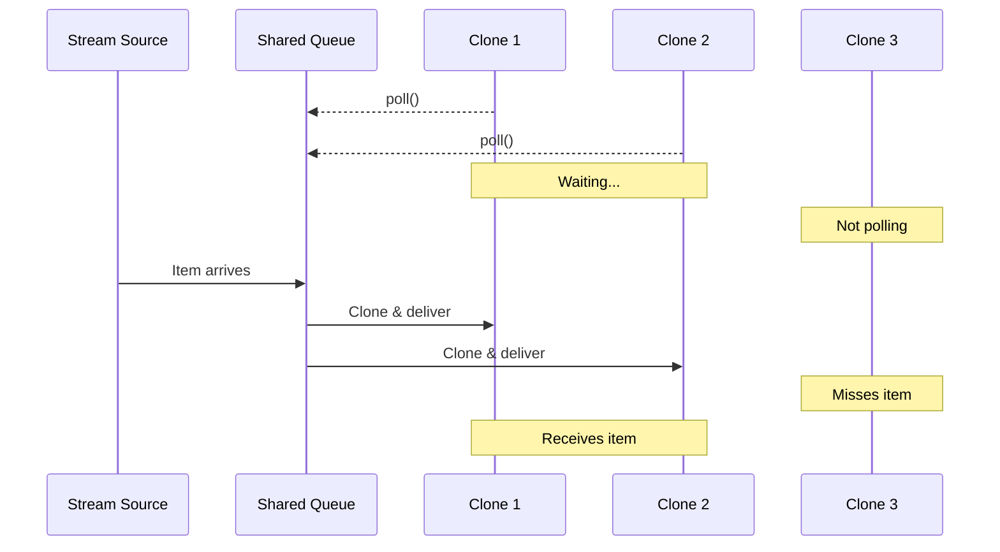

# Clone-Stream

*Lazy single-threaded stream cloning*: items are only cloned when a consumer actually polls.

## Why This Crate?

Unlike broadcast channels that eagerly clone every item for every subscriber, `clone-stream` clones **on-demand**. Items are stored once and only cloned when a consumer polls for them.

## How It Works

Items are delivered only to clones actively polling when items arrive (poll-time semantics).



The `fork()` method in this library is a kind of stream operation. Stream operators are stream *adapters*, similar to iterator adapter methods. For more information on how this library was built and how to build your own stream operators, see my [EuroRust 2025 slides](https://github.com/wvhulle/streams-eurorust-2025).

## Important

This crate requires **single-threaded async runtimes** (`tokio::main(flavor = "current_thread")` or `#[tokio::test]`). The lazy semantics depend on cooperative scheduling; multi-threaded runtimes cause race conditions.

Alternatives:

- **[`tokio::sync::broadcast`](https://docs.rs/tokio/latest/tokio/sync/broadcast/)**: Eager cloning, guaranteed delivery, multi-threaded
- **[`stream_shared`](https://crates.io/crates/stream_shared)**: Clone-time semantics (clones start from creation point)

## Installation

```bash
cargo add clone-stream
```
